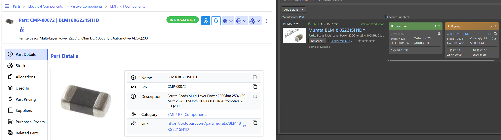
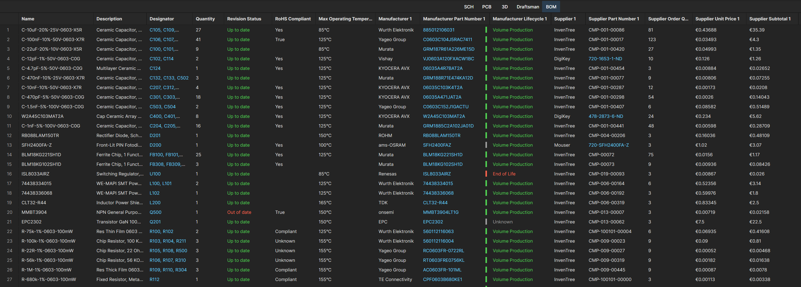

# inventree-altium-bridge (InvenTree plugin)

An InvenTree plugin to integrate your component stock as a custom part supplier in Altium. By setting your local InvenTree as part supplier with the highest priority your BOM will first use your local stock and only fall back to other suppliers if your stock is not sufficient.

The plugin builds an Altium Custom-Parts-Provider feed from the ORM (per MPN:
`Supplier=InvenTree, SPN=IPN, Stock, Price, ProductURL, Photo`) and writes
`offers.csv` to an SMB share (Altium reads it). Also served at
`…/plugin/altium-bridge/offers.csv`.

SMB is accessed directly via `smbprotocol` (credentials in plugin Settings), so
no container volume mounts are necessary.

## Plugin Settings
| Setting | Description |
|---|---|
| `SUPPLIER_LABEL` | Name shown as the supplier tile in Altium (e.g. InvenTree) |
| `MEDIA_BASE` | Prefix for relative image paths in the Photo column |
| `OFFERS_ENABLED` | Write offers.csv to the SMB share on schedule |
| `OFFERS_PATH` | Path on the share for the offer CSV |
| `SMB_HOST` | SMB/CIFS server host or IP |
| `SMB_SHARE` | Share name |
| `SMB_USER` | SMB user name |
| `SMB_PASSWORD` | SMB password |
| `SMB_DOMAIN` | SMB domain |

## Setup Altium Custom Parts Provider
Disclaimer: This feature is in **Open Beta**.

1. Advanced Settings → enable **`EDMS.CustomOffersMerge`** (Open Beta). Confirm BOM Portal is on
   and the single Custom-Parts-Provider slot is free.
2. File » New » **Custom Parts Provider Synchronization Configuration** (`.PrtSync`),
   **source = the CSV** on the mounted share (Excel/CSV file source; no OLE DB needed).
3. **Parameter Mapping** (CSV column → Altium field):
   | Altium field | CSV column |
   |---|---|
   | Key / MPN | `MPN` |
   | Manufacturer | `Manufacturer` |
   | Supplier | `Supplier` |
   | SPN | `SPN` |
   | Stock | `Stock` |
   | Unit price | `Price` (+ `Currency`) |
   | Product URL / Photo | `ProductURL` / `Photo` |
4. Sync once manually → confirm a local "InvenTree" tile appears in ActiveBOM for a stocked MPN.
5. Schedule headless: `ComponentSync.Executor.exe <config>.PrtSync` via Windows Task Scheduler
   (hourly, daily). Logs: `C:\Users\Public\Documents\Altium\Logs\ComponentSync`.
